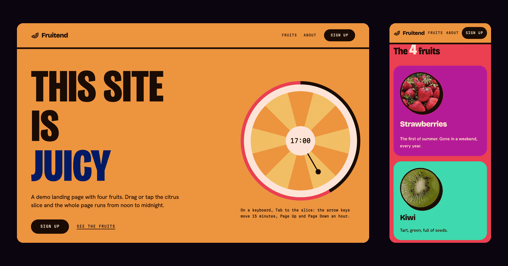

# Fruitend

Read this in: **English** | [Polski](README.pl.md)

A static demo landing page on a fruit theme. The citrus slice in the hero is drawn in CSS and is
also a 24-hour clock: it shows your local time, and the colors of the page follow the hour on it.
From 18:00 to 06:00 the page turns dark.

Live page: https://netbr3ak.github.io/fruitend/



## What the page does

- One number, `--tod`, drives the palette. 0 is noon, 0.5 is 06:00 or 18:00, and 1 is
  midnight. CSS derives the colors from it with `oklch()` relative colors. JavaScript sets only
  that number.
- From 18:00 to 06:00 the light grounds turn dark and their text turns from cocoa to cream. The
  switch is a step made in CSS with `round()`, not a blend, so no text sits on a ground it
  fails against. The four photos dim with the hour through a CSS `filter`.
- The citrus slice is a slider (`role="slider"`): noon at the top, midnight at the bottom, and
  the dark half of the ring is the night. Drag it, or focus it with Tab and use the keys: each
  arrow moves 15 minutes, Page Up and Page Down move an hour, Home jumps to 00:00 and End to
  23:59. A drag may pass noon and midnight. On a touch screen, drag the knob at the tip of the
  hand, tap the slice or drag across it sideways; a vertical swipe that starts off the knob
  scrolls the page.
- On load the clock shows your local time and moves with it every minute. Once you move it, it
  stays where you put it, and **Back to now** returns it to the clock. Add `?t=21` to the address
  to pin the page at 21:00.
- When the slice scrolls out of view, a slider with the time shows in the top bar. It moves the
  same clock.
- A jump across 06:00 or 18:00 (a key, a tap or **Back to now**) cross-fades the page in
  browsers with View Transitions. A drag changes the colors directly.
- "Three files" shows the size and load time of each file, as your browser measured them on
  this visit.
- **Inspect styles** shows the size, padding, text contrast and matching CSS rules of the element
  you hover or focus. It needs the Popover API; without it the button stays hidden.
- The ticker has a Pause button. If your system asks for reduced motion, nothing on the page
  moves and the Pause button is hidden.
- Every link works without JavaScript. "Fruits", "About" and "See the fruits" jump to their
  section; "Source", "View source" and "Make it your own" open this repository. Without
  JavaScript the clock is a still picture at 12:00, and the controls that need a script stay
  hidden.

There is no framework, no build step and no request to another server. The fonts ship with
the page.

## Run it

```bash
git clone https://github.com/NetBr3ak/fruitend.git
cd fruitend
python3 -m http.server 8000
```

Then open http://localhost:8000/. Opening `index.html` straight from the disk also works, with
one gap: the browser treats a local file as a separate origin and blocks `cssRules`, so
**Inspect styles** shows the measurements but not the source rules.

## Check the palette

```bash
node check-palette.mjs
```

The script walks `--tod` from 0 to 1 in 21 steps. At each step it checks 14 text and background
pairs against their WCAG contrast floor: 4.5:1, or 3:1 for display-size text. Then it checks 6
more pairs, the text on the grounds that turn dark at night: the day scene over `--tod` 0 to 0.5
and the night scene over 0.5 to 1, 21 steps each. It exits with code 1 if any pair falls
short. CI runs it on every push to `main` and on every pull request.

## Files

```
fruitend/
├── .github/workflows/  # CI: runs check-palette.mjs
├── fonts/              # The three fonts, cut to the characters and the one weight the page uses, and OFL.txt
├── images/             # The four fruit photos and the preview image above
├── index.html          # The page
├── styles.css          # All styles, including the palette
├── script.js           # Clock, bar slider, ticker, file sizes, inspector
├── check-palette.mjs   # Contrast check for the whole palette ramp
├── favicon.svg
├── sitemap.xml
├── LICENSE
├── README.md
└── README.pl.md        # This file in Polish
```

## Credits

The four fruit photos come from Wikimedia Commons. Each one is cropped to a square at 400 and
800 px (strawberries also at 1000 px), in AVIF and WebP, for example `kiwi-400.avif` and
`kiwi-800.webp`. The `sizes` attribute tells the browser how wide each photo shows, so it can
take the smaller file where that is enough.

| File | Photo | Author | Licence |
|---|---|---|---|
| `images/strawberries-*` | [Strawberries in basket 2018 G1](https://commons.wikimedia.org/wiki/File:Strawberries_in_basket_2018_G1.jpg) | George Chernilevsky | Public domain |
| `images/kiwi-*` | [Kiwi-halbiert](https://commons.wikimedia.org/wiki/File:Kiwi-halbiert.jpg) | MartinThoma | CC0 1.0 |
| `images/pineapple-*` | [Ananas bozor rastasida](https://commons.wikimedia.org/wiki/File:Ananas_bozor_rastasida.jpg) | Usmonov Gayrat | CC0 1.0 |
| `images/blueberries-*` | [Aberdeenshire blueberries](https://commons.wikimedia.org/wiki/File:Aberdeenshire_blueberries.jpg) | Mx. Granger | CC0 1.0 |

The three fonts are Bricolage Grotesque, Hanken Grotesk and Martian Mono, all under the SIL Open
Font License. See [fonts/OFL.txt](fonts/OFL.txt).

## License

The code is under the MIT License. See [LICENSE](LICENSE). The photos and fonts keep the
licences listed in Credits.
