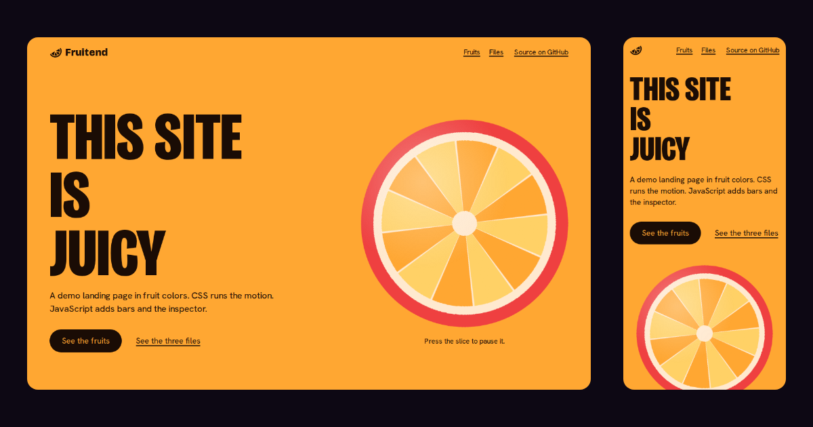

# Fruitend

Read this in: **English** | [Polski](README.pl.md)

A one-page demo in fruit colors, made of three files: `index.html`, `styles.css` and `script.js`.
The citrus slice is drawn with CSS gradients. As you scroll, each band takes the color of its
fruit.

Live page: https://netbr3ak.github.io/fruitend/



## What the page does

Everything moves by itself: on arrival, or when a part scrolls into view. Nothing needs a click.

| What moves | Starts on | How |
|---|---|---|
| The title squeezes from full width to condensed, line by line | Arrival | `font-stretch` drives the font's width axis; `sibling-index()` sets each line's delay |
| The slice cuts itself open | Arrival | A registered `--cut` angle sweeps a conic mask |
| The slice turns once a minute | Arrival | `rotate`, endless |
| The slice turns a further 90 degrees as it leaves the view | Scroll | `animation-timeline: view()` on `transform` |
| Juice drips off the hero | Scroll | A `shape()` clip path in percent units, grown with `scale` |
| Each band floods from the previous fruit's color to its own | Scroll | A registered `--flood` percentage inside `color-mix(in oklch, ...)` |
| The file size bars grow | Scroll | `view()` timeline on `scale` |
| The letters of the footer word rise one by one | Scroll | `view()` timeline, staggered with `sibling-index()` |

- **Pause.** The slice is the only motion that loops. Click it, or press Space or Enter while it
  has focus, to pause it; press again to resume. It is a native checkbox with the switch role, so
  the pause works without JavaScript (Enter comes from `script.js`).
- **Reduced motion.** If your system asks for reduced motion, nothing moves. The bands still
  change color as you scroll, and the pause switch and its hint are not shown.
- **Light and dark.** The page follows your system setting. Dark grounds keep each fruit's hue at
  one fixed lightness, built with relative color (`oklch(from ...)`) and picked with
  `light-dark()`. On a wide-gamut screen the fruit colors take more chroma (`color-gamut: p3`).
- **Files.** The Files section shows the compressed size of each of the three files, as your
  browser received them on this visit, and a running total of every file the visit loaded. It
  reads Resource Timing through a `PerformanceObserver`.
- **Inspect the CSS.** A popover that shows the size, padding, text contrast and matching CSS
  rules of the element you point at or tab to, with each rule's `@layer`, `@media`, `@supports`
  and `@container` chain. A dashed outline follows the element through CSS anchor positioning.

### Without a feature

Each newer feature sits behind `@supports` or a feature test, and the page stays complete
without it.

| Missing | What you see |
|---|---|
| Scroll-driven animations | Each band in its own color, the drip at full length, static bars and letters, a whole slice with no entrance |
| `sibling-index()` | The title lines and footer letters move together |
| `shape()` | No drip, a straight edge |
| `light-dark()` or relative color | The light theme |
| `text-box` | Headings keep a 0.86 line height |
| Anchor positioning | No outline; the inspector still names the element and its box |
| Popover | No **Inspect the CSS** button |
| JavaScript | All text, photos and links; the slice still turns and pauses on Space or a click; no sizes and no inspector |

There is no framework, no build step and no request to another server. The fonts ship with the
page. The Content Security Policy allows only the page's own files and requires Trusted Types.

## Run it

```bash
git clone https://github.com/NetBr3ak/fruitend.git
cd fruitend
python3 -m http.server 8000
```

Then open http://localhost:8000/. Opening `index.html` straight from the disk also works, with
two gaps: the browser treats a local file as a separate origin and blocks `cssRules`, so
**Inspect the CSS** shows the measurements but not the rules, and file sizes read 0, so the
Files section shows no sizes.

## Check the palette

```bash
node check-palette.mjs
```

The script reads the palette from `styles.css`. It checks that each color sits inside sRGB (and
the wide-gamut values inside Display P3), every text and background pair the page uses in light
and dark against its WCAG contrast floor (4.5:1, or 3:1 for headings), and every 5% step of each
color flood. It prints one line per check and exits with code 1 if any check fails. CI runs it
on every push to `main` and on every pull request.

## Files

```
fruitend/
├── .github/workflows/  # CI: runs check-palette.mjs
├── fonts/              # Two fonts, cut to the characters and the one weight the page uses, and OFL.txt
├── images/             # Four fruit photos, four sticker drawings (SVG) and the preview image above
├── index.html          # The page
├── styles.css          # All styles, including the palette and all motion
├── script.js           # Enter for the slice switch, file sizes, inspector
├── check-palette.mjs   # Gamut and contrast check for the palette
├── favicon.svg
├── sitemap.xml
├── LICENSE
├── README.md
└── README.pl.md        # This file in Polish
```

## Credits

The four fruit photos come from Wikimedia Commons. Each one is cropped to a square at 400 and
800 px (strawberries also at 1000 px), in AVIF and WebP, for example `kiwi-400.avif` and
`kiwi-800.webp`. The `sizes` attribute tells the browser how wide each photo shows, so it can
take the smaller file where that is enough.

| File | Photo | Author | Licence |
|---|---|---|---|
| `images/strawberries-*` | [Strawberries in basket 2018 G1](https://commons.wikimedia.org/wiki/File:Strawberries_in_basket_2018_G1.jpg) | George Chernilevsky | Public domain |
| `images/kiwi-*` | [Kiwi-halbiert](https://commons.wikimedia.org/wiki/File:Kiwi-halbiert.jpg) | MartinThoma | CC0 1.0 |
| `images/pineapple-*` | [Ananas bozor rastasida](https://commons.wikimedia.org/wiki/File:Ananas_bozor_rastasida.jpg) | Usmonov Gayrat | CC0 1.0 |
| `images/blueberries-*` | [Aberdeenshire blueberries](https://commons.wikimedia.org/wiki/File:Aberdeenshire_blueberries.jpg) | Mx. Granger | CC0 1.0 |

The two fonts are Bricolage Grotesque and Hanken Grotesk, both under the SIL Open Font License.
See [fonts/OFL.txt](fonts/OFL.txt). Bricolage Grotesque is an instance with the optical size
pinned at 96; its width axis stays, so CSS can squeeze the headings.

## License

The code is under the MIT License. See [LICENSE](LICENSE). The photos and fonts keep the
licences listed in Credits.
