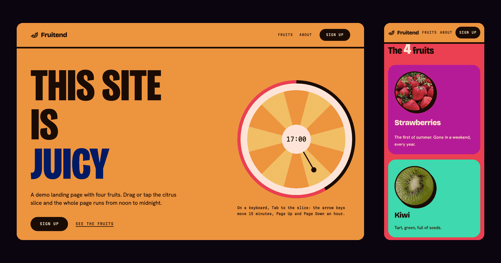

# Fruitend

Czytaj w: [English](README.md) | **Polski**

Statyczna strona demo w owocowym motywie. Plaster cytrusa na górze strony jest narysowany w CSS
i jest też zegarem: przeciągnij go, a sześć kolorowych bloków strony przesunie się od południa
do północy.

Strona na żywo: https://netbr3ak.github.io/fruitend/



## Co robi strona

- Jedna liczba, `--tod`, steruje paletą. 0 to południe, 1 to północ. CSS wyprowadza z niej
  sześć kolorów przez kolory względne `oklch()`. JavaScript ustawia tylko tę liczbę.
- Plaster cytrusa to suwak (`role="slider"`), a w jego środku widać godzinę. Przeciągnij go
  albo przejdź do niego klawiszem Tab i użyj klawiszy: każda strzałka to 15 minut, Page Up
  i Page Down to godzina, Home i End skaczą do południa i do północy. Przeciąganie za 12
  zatrzymuje się w południe albo o północy. Na ekranie dotykowym przeciągnij gałkę na końcu
  wskazówki, stuknij plaster albo przeciągnij po nim w bok; ruch w pionie zaczęty poza gałką
  przewija stronę.
- Po wczytaniu zegar pokazuje twój czas lokalny. Skala zaczyna się w południe, więc godzina
  przed południem pokazuje południe. Dopisz `?t=21` do adresu, aby przypiąć stronę do 21:00.
- **Inspect styles** pokazuje rozmiar, padding, kontrast tekstu i pasujące reguły CSS elementu pod
  kursorem albo z fokusem.
- Pasek z tekstem ma przycisk Pause. Jeśli system prosi o ograniczenie ruchu, nic na stronie
  się nie rusza, a przycisk Pause jest ukryty.
- Każdy link działa bez JavaScriptu. "Fruits", "About" i "See the fruits" przewijają do
  swojej sekcji; "Source", "View source" i "Make it your own" otwierają to repozytorium.

Nie ma frameworka, budowania ani zapytań do innego serwera. Fonty leżą obok strony.

## Jak uruchomić

```bash
git clone https://github.com/NetBr3ak/fruitend.git
cd fruitend
python3 -m http.server 8000
```

Potem otwórz http://localhost:8000/. Plik `index.html` otwarty prosto z dysku też działa,
z jedną luką: przeglądarka traktuje plik lokalny jak inne pochodzenie i blokuje `cssRules`,
więc **Inspect styles** pokazuje pomiary, ale nie reguły źródłowe.

## Sprawdzenie palety

```bash
node check-palette.mjs
```

Skrypt przechodzi `--tod` od 0 do 1 w 21 krokach. W każdym kroku sprawdza 14 par tekstu i tła
względem progu kontrastu WCAG: 4,5:1 albo 3:1 dla dużego tekstu. Kończy się kodem 1, jeśli
któraś para nie spełnia progu. CI uruchamia go przy każdym pushu do `main` i przy każdym pull
requeście.

## Pliki

```
fruitend/
├── .github/workflows/  # CI: uruchamia check-palette.mjs
├── fonts/              # Trzy fonty, okrojone do znaków i jednej grubości ze strony, i OFL.txt
├── images/             # Cztery zdjęcia owoców i obraz podglądu powyżej
├── index.html          # Strona
├── styles.css          # Wszystkie style, razem z paletą
├── script.js           # Zegar, pasek, inspektor
├── check-palette.mjs   # Sprawdzenie kontrastu całej skali palety
├── favicon.svg
├── sitemap.xml
├── LICENSE
├── README.md           # Angielska wersja tego pliku
└── README.pl.md
```

## Źródła

Cztery zdjęcia owoców pochodzą z Wikimedia Commons. Każde jest przycięte do kwadratu 360 px,
z kopiami 300 px i 200 px (`*-300.webp`, `*-200.webp`) dla ekranów, którym tyle wystarczy.

| Plik | Zdjęcie | Autor | Licencja |
|---|---|---|---|
| `images/strawberries.webp` | [Strawberries in basket 2018 G1](https://commons.wikimedia.org/wiki/File:Strawberries_in_basket_2018_G1.jpg) | George Chernilevsky | domena publiczna |
| `images/kiwi.webp` | [Kiwi-halbiert](https://commons.wikimedia.org/wiki/File:Kiwi-halbiert.jpg) | MartinThoma | CC0 1.0 |
| `images/pineapple.webp` | [Ananas bozor rastasida](https://commons.wikimedia.org/wiki/File:Ananas_bozor_rastasida.jpg) | Usmonov Gayrat | CC0 1.0 |
| `images/blueberries.webp` | [Aberdeenshire blueberries](https://commons.wikimedia.org/wiki/File:Aberdeenshire_blueberries.jpg) | Mx. Granger | CC0 1.0 |

Trzy fonty to Bricolage Grotesque, Hanken Grotesk i Martian Mono, wszystkie na licencji SIL Open
Font License. Zobacz [fonts/OFL.txt](fonts/OFL.txt).

## Licencja

Kod jest na licencji MIT. Zobacz [LICENSE](LICENSE) (po angielsku). Zdjęcia i fonty mają
licencje podane w sekcji Źródła.
