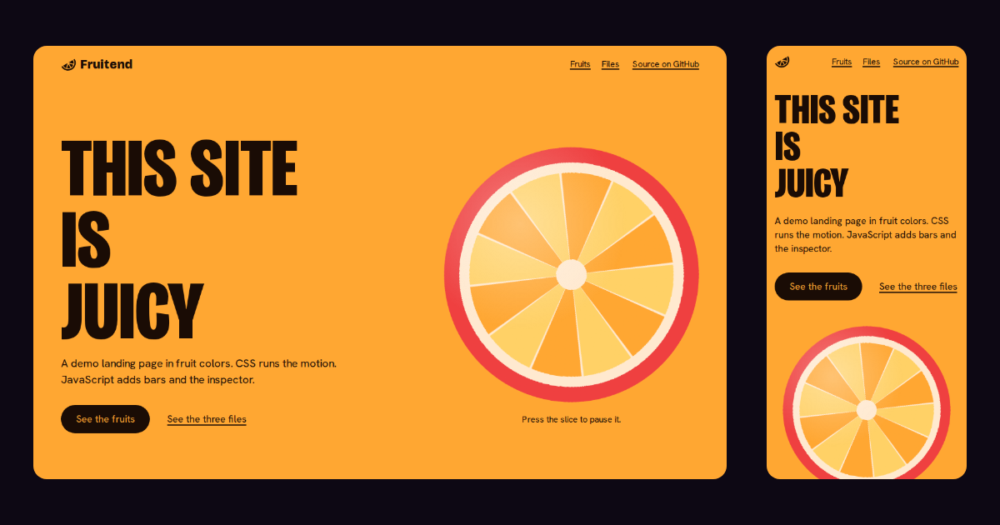

# Fruitend

Czytaj w: [English](README.md) | **Polski**

Jednostronicowe demo w owocowych kolorach, zrobione z trzech plików: `index.html`, `styles.css`
i `script.js`. Plaster cytrusa jest narysowany gradientami CSS. Gdy przewijasz, każdy pas strony
przybiera kolor swojego owocu.

Strona na żywo: https://netbr3ak.github.io/fruitend/



## Co robi strona

Wszystko rusza samo: po wejściu na stronę albo gdy dana część wjedzie w widok. Nic nie wymaga
kliknięcia.

| Co się rusza | Kiedy rusza | Jak |
|---|---|---|
| Tytuł zwęża się z pełnej szerokości do wąskiej, linia po linii | Po wejściu | `font-stretch` steruje osią szerokości fontu; `sibling-index()` ustala opóźnienie każdej linii |
| Plaster sam się rozcina | Po wejściu | Zarejestrowany kąt `--cut` przesuwa maskę stożkową |
| Plaster robi pełny obrót raz na minutę | Po wejściu | `rotate`, bez końca |
| Plaster obraca się o kolejne 90 stopni, gdy znika z widoku | Przewijanie | `animation-timeline: view()` na `transform` |
| Z góry strony kapie sok | Przewijanie | Ścieżka `shape()` w procentach, wydłużana przez `scale` |
| Każdy pas przechodzi od koloru poprzedniego owocu do swojego | Przewijanie | Zarejestrowany procent `--flood` w `color-mix(in oklch, ...)` |
| Paski rozmiarów plików rosną | Przewijanie | Oś czasu `view()` na `scale` |
| Litery słowa w stopce wychodzą po kolei | Przewijanie | Oś czasu `view()`, przesunięta przez `sibling-index()` |

- **Pauza.** Plaster to jedyny ruch, który się zapętla. Kliknij go albo naciśnij spację lub
  Enter, gdy ma fokus, a się zatrzyma; kolejne naciśnięcie go wznawia. To zwykłe pole wyboru
  z rolą przełącznika, więc pauza działa bez JavaScriptu (Enter dodaje `script.js`).
- **Ograniczony ruch.** Jeśli system prosi o ograniczenie ruchu, nic się nie rusza. Pasy nadal
  zmieniają kolor przy przewijaniu, a przełącznik pauzy i podpowiedź pod nim się nie pokazują.
- **Jasny i ciemny motyw.** Strona idzie za ustawieniem systemu. Ciemne tła trzymają odcień
  każdego owocu przy jednej stałej jasności: buduje je kolor względny (`oklch(from ...)`), a
  wybiera `light-dark()`. Na ekranie z szeroką gamą kolory owoców są bardziej nasycone
  (`color-gamut: p3`).
- **Pliki.** Sekcja Files pokazuje zapisane rozmiary z tej wizyty oraz ich bieżącą sumę.
  Rozmiary są skompresowane tylko wtedy, gdy serwer kompresuje pliki. Dane pochodzą
  z Resource Timing, czytanego przez `PerformanceObserver`. Niektóre przeglądarki
  pomijają rozmiary, więc suma może być niepełna.
- **Inspect the CSS.** Okienko (popover), które pokazuje rozmiar, padding, kontrast tekstu
  i pasujące reguły CSS elementu pod kursorem albo z fokusem, razem z łańcuchem `@layer`,
  `@media`, `@supports` i `@container` każdej reguły. Przerywana ramka idzie za elementem dzięki
  pozycjonowaniu względem kotwicy (anchor positioning) w CSS.

### Gdy przeglądarka czegoś nie ma

Każda nowsza funkcja siedzi za `@supports` albo za testem w skrypcie, a strona bez niej nadal
jest kompletna.

| Brakuje | Co widać |
|---|---|
| Animacji sterowanych przewijaniem | Każdy pas w swoim kolorze, sok w pełnej długości, nieruchome paski i litery, cały plaster bez wejścia |
| `sibling-index()` | Linie tytułu i litery w stopce ruszają razem |
| `shape()` | Brak kapiącego soku, prosta krawędź |
| `light-dark()` albo koloru względnego | Jasny motyw |
| `text-box` | Nagłówki mają wysokość linii 0,86 |
| Składni przestrzeni kolorów gradientu | Zwykłe gradienty stożkowe nadal rysują plaster |
| `text-wrap: pretty` | Akapity mają zwykłe łamanie wierszy |
| Pozycjonowania względem kotwicy | Brak ramki; inspektor nadal podaje element i jego wymiary |
| Popover | Brak przycisku **Inspect the CSS** |
| JavaScriptu | Cały tekst, zdjęcia i linki; plaster nadal się obraca i staje po spacji albo kliknięciu; brak rozmiarów i inspektora |

Nie ma frameworka, budowania ani zapytań do innego serwera. Fonty leżą obok strony. Content
Security Policy pozwala tylko na własne pliki strony i wymaga Trusted Types.

## Jak uruchomić

```bash
git clone https://github.com/NetBr3ak/fruitend.git
cd fruitend
python3 -m http.server 8000
```

Potem otwórz http://localhost:8000/. Plik `index.html` otwarty prosto z dysku też działa,
z ograniczeniami: zabezpieczenia przeglądarki mogą blokować fonty lub reguły CSS.
**Inspect the CSS** nadal pokazuje pomiary, a sekcja Files nie pokazuje rozmiarów.
Pełna strona działa po udostępnieniu folderu przez HTTP. Gdy font jest zablokowany lub
dociera za późno, przeglądarka używa fontu systemowego. Nagłówki mogą się zawijać.

## Sprawdzenie palety

```bash
node check-palette.mjs
```

Skrypt czyta paletę z `styles.css`. Sprawdza, czy każdy kolor mieści się w sRGB (a wartości dla
szerokiej gamy w Display P3), każdą parę tekstu i tła ze strony w jasnym i ciemnym motywie
względem progu kontrastu WCAG (4,5:1 albo 3:1 dla nagłówków) oraz każdy krok co 5% w każdym
przejściu koloru. Wypisuje jedną linię na sprawdzenie i kończy się kodem 1, jeśli któreś nie
przejdzie. CI uruchamia go przy każdym pushu do `main` i przy każdym pull requeście.

## Pliki

```
fruitend/
├── .github/workflows/  # CI: uruchamia check-palette.mjs
├── fonts/              # Dwa fonty, okrojone do znaków i jednej grubości ze strony, i OFL.txt
├── images/             # Cztery zdjęcia owoców, cztery rysunki naklejek (SVG) i obraz podglądu powyżej
├── index.html          # Strona
├── styles.css          # Wszystkie style, razem z paletą i całym ruchem
├── script.js           # Enter dla przełącznika plastra, rozmiary plików, inspektor
├── check-palette.mjs   # Sprawdzenie gamy i kontrastu palety
├── favicon.svg
├── sitemap.xml
├── LICENSE
├── README.md           # Angielska wersja tego pliku
└── README.pl.md
```

## Źródła

Cztery zdjęcia owoców pochodzą z Wikimedia Commons. Każde jest przycięte do kwadratu 400 i 800 px
(truskawki także 1000 px), w AVIF i WebP, na przykład `kiwi-400.avif` i `kiwi-800.webp`.
Atrybut `sizes` mówi przeglądarce, jak szerokie jest każde zdjęcie na stronie, więc może wziąć
mniejszy plik tam, gdzie wystarczy.

| Plik | Zdjęcie | Autor | Licencja |
|---|---|---|---|
| `images/strawberries-*` | [Strawberries in basket 2018 G1](https://commons.wikimedia.org/wiki/File:Strawberries_in_basket_2018_G1.jpg) | George Chernilevsky | domena publiczna |
| `images/kiwi-*` | [Kiwi-halbiert](https://commons.wikimedia.org/wiki/File:Kiwi-halbiert.jpg) | MartinThoma | CC0 1.0 |
| `images/pineapple-*` | [Ananas bozor rastasida](https://commons.wikimedia.org/wiki/File:Ananas_bozor_rastasida.jpg) | Usmonov Gayrat | CC0 1.0 |
| `images/blueberries-*` | [Aberdeenshire blueberries](https://commons.wikimedia.org/wiki/File:Aberdeenshire_blueberries.jpg) | Mx. Granger | CC0 1.0 |

Dwa fonty to Bricolage Grotesque i Hanken Grotesk, oba na licencji SIL Open Font License.
Zobacz [fonts/OFL.txt](fonts/OFL.txt). Bricolage Grotesque to wersja z rozmiarem optycznym
ustalonym na 96; oś szerokości zostaje, więc CSS może zwężać nagłówki.

## Licencja

Kod jest na licencji MIT. Zobacz [LICENSE](LICENSE) (po angielsku). Zdjęcia i fonty mają
licencje podane w sekcji Źródła.
